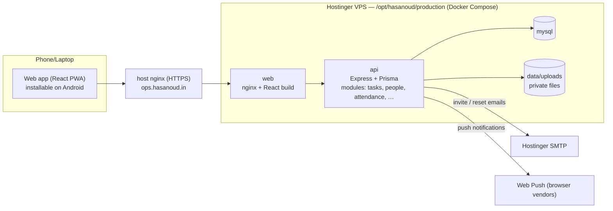

# HLD — Hasanoud Operations platform

Status: **draft for review**. Covers the whole platform at a high level; each module gets its own LLD before it is built.

## 1. Goal

One web platform at **ops.hasanoud.in** for Hasanoud's operations. Every capability is a **feature (module)** of the same app, sharing one login, one set of users and permissions, one database. The existing task manager becomes the first module.

## 2. Shape: modular monolith ([ADR-001](../adr/001-modular-monolith.md))

- **One codebase, one deploy, one database.** Inside the API, each feature is a module folder (`modules/tasks`, `modules/people`, `modules/attendance`, …) with its own routes, service and data access. Modules talk to each other through each other's service functions, never by reaching into another module's tables directly.
- **Shared core** used by all modules: authentication, users, roles and permissions (RBAC matrix + per-user special permissions), locations, reporting hierarchy, holidays, audit log, file storage, notifications.
- **Single API instance.** The rate limiter, permission cache and scheduled jobs run in-process today. When a separate worker or a second instance is needed (e.g. Shopify webhooks), they move to Redis first.

## 3. Modules and order

| # | Module | Depends on | Status |
|---|---|---|---|
| 0 | Core (auth, users, RBAC, locations, holidays, audit, files, notifications) | — | Exists; extended by module 2 |
| 1 | Tasks | Core | Exists |
| 2 | **People + Attendance** | Core | **LLD written** |
| 3 | Leave, Salary | People, Attendance | Later |
| 4 | Products + stock (warehouse, shop, transfers), BOM / production | Core | Later |
| 5 | Vendors + purchase | Stock | Later |
| 6 | Sales: shop sales, Shopify orders, Shiprocket shipping | Stock | Later; Vinculum keeps print/cancel |
| 7 | Expenses + MIS (income/expense view), Tally export | Sales, Purchase, Expenses | Later |

## 4. External systems

| System | Used for | When |
|---|---|---|
| Hostinger SMTP | Invite and password emails | Now |
| Web Push | Attendance reminders | Module 2 |
| Shopify (webhooks/API) | Orders | Module 6 |
| Shiprocket (API, CSV) | Shipping status, COD remittance | Module 6–7 |
| Gokwik, Razorpay (CSV) | Prepaid remittance | Module 7 |
| Tally | Accounting (stays in Tally); export of invoices/vouchers | Module 7 |
| Vinculum | Invoice/label/challan printing, cancellation — **stays outside the platform** | — |
| SalaryBox | Attendance during transition, runs in parallel | Until switched off |

## 5. Cross-cutting rules

- **Security:** company-email-only logins; httpOnly cookie sessions; sessions revoked on password change and on deactivation; sensitive numbers (Aadhaar, PAN, bank account) encrypted in the database; uploaded files served only to logged-in users with permission; every sensitive change and every "show full number" written to the audit log.
- **Screens:** one app for everyone; employee screens mobile-first, HR/admin screens desktop-first, menus by permission ([ADR-004](../adr/004-one-app-screens-by-audience.md)).
- **Time:** all business rules in **IST**; server time is the source of truth.
- **Data:** nothing is hard-deleted where history matters (employees, punches, approvals). Records are deactivated or marked.
- **Environments:** production (`/opt/hasanoud/production`) and **staging** (`/opt/hasanoud/staging`, needed before the attendance launch — GPS and camera need HTTPS on real phones).
- **Backups:** daily MySQL dump + uploads on the server (14 days) and off-site copy to S3 (90 days). See [deploy/DEPLOY.md](../../deploy/DEPLOY.md).

## 6. Domains

- `ops.hasanoud.in` — the platform (new DNS record → VPS).
- `task.hasanoud.in` — *proposed:* redirect to `ops.hasanoud.in` once it is live (to confirm).
